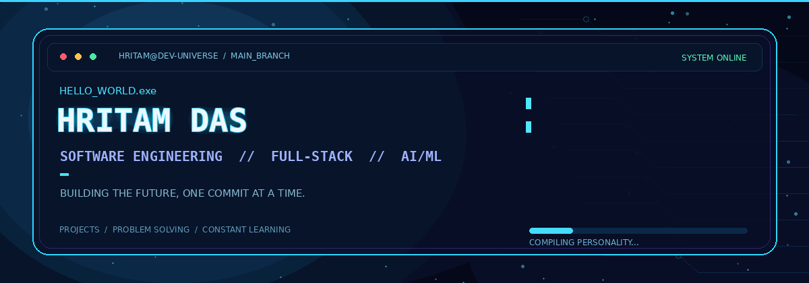

<!--
  Hritam Das | GitHub Profile README
  Repository: https://github.com/dashritam08-raj/dashritam08-raj
  Keep hritam_animated_github_banner.gif in this repository's root folder.
-->

  

  
  
  

  

I'm a Computer Science and Engineering undergraduate at Meghnad Saha Institute of Technology (MSIT). I enjoy turning ideas into practical software and strengthening my engineering fundamentals by building, debugging, and iterating on projects.
- 🎯 Primary direction: Software Development Engineering (SDE)
- 🧱 Areas I work with: Full-stack development, backend APIs, data analytics, and AI-assisted applications
- 🧠 Currently strengthening: Data structures and algorithms, backend engineering, and core computer science
- 🌏 Based in: Kolkata, India
- 🤝 Approach: Build useful things, verify the output, learn from failures, and improve the next version
tech_stack

  

Area	Technologies
Languages	Python · Java · JavaScript · C · Dart · R · SQL
Frontend	HTML · CSS · React
Backend & APIs	Node.js · Express.js · Flask · FastAPI · REST APIs
Data & Visualization	Pandas · NumPy · Matplotlib · Seaborn · Power BI · Tableau · Excel
Databases	MongoDB · MySQL · SQLite
Tools & Cloud	Git · GitHub · Linux · VS Code · Jupyter · Anaconda · AWS · Azure
CS Foundations	Data Structures & Algorithms · OOP · DBMS · Operating Systems · Computer Networks

featured_projects
A selection of projects from my GitHub. Open each repository for its implementation, setup instructions, and current status.
<table>
  <tr>
    <td width="50%" valign="top">
      <h3>🔎 <a href="https://github.com/dashritam08-raj/PARAKH">PARAKH</a></h3>
      
<b>AI-assisted Legal Metrology compliance inspection</b>

      A decision-support prototype for reviewing packaged-product labels against structured Legal Metrology requirements. Its workflow includes OCR-based field extraction, rule-based checks, human review, inspection history, and PDF reports.
      
Python · FastAPI · React · Vite · Tesseract OCR · SQLite

      
<a href="https://github.com/dashritam08-raj/PARAKH">View repository →</a>

    </td>
    <td width="50%" valign="top">
      <h3>🛟 <a href="https://github.com/dashritam08-raj/RAKSHA-AI">RAKSHA AI</a></h3>
      
<b>Disaster intelligence & emergency response</b>

      A disaster command platform bringing together incident information, GPS/SOS workflows, environmental feeds, alerts, operational risk indicators, and an ML decision-support layer.
      
Python · FastAPI · JavaScript · SQLite/PostgreSQL support

      
<a href="https://github.com/dashritam08-raj/RAKSHA-AI">View repository →</a>

    </td>
  </tr>
  <tr>
    <td width="50%" valign="top">
      <h3>🌱 <a href="https://github.com/dashritam08-raj/ecotrack">EcoTrack AI</a></h3>
      
<b>Sustainability analytics</b>

      An interactive app focused on exploring sustainability-related data and presenting insights through a Streamlit interface.
      
Python · Streamlit · Pandas · Data visualization

      
<a href="https://ecotrack-kqdpzxreiq5kfuqsavexkz.streamlit.app/">Launch live demo →</a> · <a href="https://github.com/dashritam08-raj/ecotrack">Source code →</a>

    </td>
    <td width="50%" valign="top">
      <h3>💫 <a href="https://github.com/dashritam08-raj/love-compass">Love Compass</a></h3>
      
<b>Flutter mobile-app project</b>

      A Dart and Flutter project. Visit the repository for the current implementation and project updates.
      
Flutter · Dart

      
<a href="https://github.com/dashritam08-raj/love-compass">View repository →</a>

    </td>
  </tr>
</table>

engineering_mindset
class Engineer:
    focus = ["problem solving", "clean implementation", "continuous learning"]

    def improve(self, idea):
        prototype = build(idea)
        feedback = test_and_debug(prototype)
        return iterate(prototype, feedback)
- 🧩 Practising problem-solving and core CS concepts.
- 🛠️ Learning through end-to-end project work—from implementation and debugging to documentation.
- 🏅 Personal highlights: Smart India Hackathon participation (2025 and 2026), and a Semester Topper Award / scholarship.
- 📚 Continuing to develop skills through coursework, workshops, and hands-on experimentation.
github_telemetry

  
  

  

  

connect

  
  

   
  <i>Build with purpose. Learn in public. Improve every iteration.</i>
    
  

